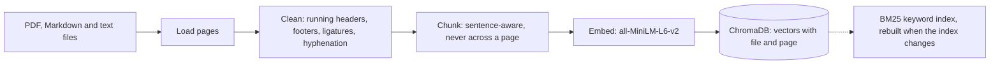
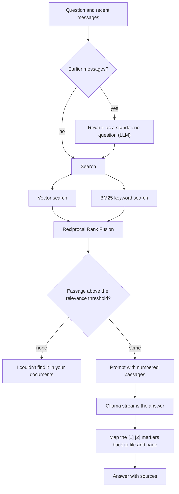

# VectorNote

[](https://github.com/itsya-ssine/VectorNote/actions/workflows/ci.yml)
[](LICENSE)
[](https://vector-note.vercel.app/)

Offline, privacy-first RAG study assistant. Ingest your semester PDFs, slides and notes, then search them locally, with every result tied to the file and page it came from. No cloud API, no cost, and your documents never leave your machine.

**Stack:** Python 3.11+, FastAPI, ChromaDB, sentence-transformers (`all-MiniLM-L6-v2`), Ollama, React + TypeScript (Vite). **[Live demo](https://vector-note.vercel.app/)**: the same UI on canned answers, no install needed (the real thing runs on your machine with your documents).

**Results at a glance** (46-question evaluation set, details in [Evaluation](#evaluation)):

- The right page is in the top 3 search results for **100%** of the 35 answerable questions (and first for 77%), in about 20 ms.
- The local model answered 97% of them and correctly refused **all 7** unanswerable ones with "I couldn't find it in your documents".
- Everything runs on your machine: no cloud API, no account, no cost.

## Status

Version 1.0. The full question-answering pipeline works from the command line, the API and a web UI: ingest, hybrid search, and cited answers from a local LLM through Ollama. The evaluation harness, a 46-question evaluation set and the benchmarks (retrieval, chunk sizes, answers) are done (see [Evaluation](#evaluation)), and the web UI is feature complete (see [Web UI](#web-ui)). The public demo is live. What is left is optional: a reranker, and the limits listed under [Limitations](#limitations).0.0 release, plus an optional reranker.0.0 release, plus an optional reranker. See the [roadmap](#roadmap).

| Works today | Coming next |
|---|---|
| PDF / Markdown / text ingestion with cleaning | Demo recording (guide: [docs/DEMO.md](docs/DEMO.md)) |
| Sentence-aware chunking with page-level citations | Reranking (optional) |
| Incremental indexing (unchanged files are skipped) | |
| Vector, BM25 keyword and hybrid (RRF) search from the CLI | |
| Cited answers from a local LLM (`ask`, `POST /ask`), with an "I couldn't find it" path | |
| Streaming answers word by word (CLI and Server-Sent Events) | |
| Conversation memory: follow-ups like "explain that more" are rewritten before searching (`chat`) | |
| FastAPI endpoints for upload (size-limited, safe file names), listing, delete, health and questions | |
| Evaluation harness: question-set tools and `eval run` (hit rate, MRR, latency, citations, refusals) | |
| Evaluation set: 46 questions with expected pages (`eval/questions.jsonl`) | |
| Benchmarks: retrieval (vector, BM25, hybrid), chunk sizes, tuned relevance threshold, answer quality | |
| Web UI: streaming chat with follow-ups and a stop button, clickable citations with copy buttons, upload with progress, document list with delete, per-document search filter, keyboard shortcuts, mobile layout | |
| [Live demo on Vercel](https://vector-note.vercel.app/) with canned answers and no backend | |
| Docker: `docker compose up` starts the API, the web UI and Ollama, and runs offline after the first start | |

## How it works

**Indexing a document:**



**Answering a question:**



- **Cleaning** removes running headers, footers and page numbers, fixes ligatures and hyphenated line breaks, and keeps the original page numbers.
- **Chunking** never crosses a page, so every chunk maps to one `[file, page]` citation. Chunk IDs are stable, and files are tracked by content hash.
- **Answers are grounded:** the model only sees the numbered passages that passed a relevance check (`VECTORNOTE_MIN_RELEVANCE`, a minimum cosine similarity). It must cite them as `[1]`, `[2]`, and the citations are mapped back to file and page. If nothing relevant is found, or the model says the passages do not contain the answer, you get "I couldn't find it in your documents" (in French if you asked in French) and no answer is made up.
- **Conversations work:** a follow-up like "explain that more" is first rewritten by the model into a standalone question using the latest messages (citations stripped, long messages cut), and that is what gets searched and answered. If the rewrite looks wrong (empty, too long, an answer instead of a question) the original question is used. The server stores nothing; clients send the history with each request.
- **Search has three modes:** `vector` (embeddings, understands paraphrases), `bm25` (exact words, acronyms, identifiers) and `hybrid` (default: both, merged with Reciprocal Rank Fusion, so a passage that ranks well in both lists wins). The keyword index is rebuilt automatically when the index changes, even if another process (such as the CLI) changed it.
- **Indexing is incremental:** re-running `ingest` skips unchanged files and re-indexes edited ones. An edit replaces the old chunks only after the new ones were embedded successfully.

## Quick start

Requirements: [uv](https://docs.astral.sh/uv/), Python 3.11+, and (for the UI) Node 20+. Ollama is only needed for `ask`.

```bash
git clone https://github.com/itsya-ssine/VectorNote.git
cd VectorNote
uv sync

# 1. Put your files in data/ (PDF, .md, .txt) and index them
cp ~/lectures/*.pdf data/
uv run vectornote ingest

# 2. Search them
uv run vectornote search "what are the four conditions for deadlock?"

# 3. Ask questions (needs Ollama: https://ollama.com)
ollama pull llama3.2:3b
uv run vectornote ask "What are the four conditions for deadlock?"

# 4. Or have a conversation: follow-up questions work
uv run vectornote chat
```

The first `ingest` downloads the embedding model once (about 90 MB) into the Hugging Face cache. After that you can set `HF_HUB_OFFLINE=1` to guarantee nothing touches the network.

### Run everything with Docker

If you have Docker, one command starts the API, the web UI and Ollama, with nothing else to install:

```bash
docker compose up --build        # or: make docker-up
```

Open <http://localhost:3000>. The first start downloads the language model (about 2 GB, once) and builds the images, which takes a few minutes. After that it starts in seconds and works without a network connection.

**Without cloning or building**, run the images published for each release on GitHub's container registry:

```bash
mkdir -p data && curl -O https://raw.githubusercontent.com/itsya-ssine/VectorNote/main/docker-compose.prebuilt.yml
docker compose -f docker-compose.prebuilt.yml up
```

`VECTORNOTE_VERSION=1.0.0` pins a release (the default is the latest). The images are built for amd64 (Intel and AMD); on Apple Silicon Docker runs them through emulation, or you can build natively with `docker compose up --build`.

- **Your documents:** drop files into `data/` (it is mounted into the container) or upload them in the UI. Index files you copied by hand with `docker compose exec api vectornote ingest`.
- **Your data stays here:** `data/` is a folder on your machine, the index lives in the `chroma` volume, and the models in the `ollama` volume. The image never contains your documents (only `src/` and the lock file are copied into the build), and the embedding model is baked in at build time, so the API container runs with `HF_HUB_OFFLINE=1`.
- **Ports:** the UI is on 3000 and the API (with docs at `/docs`) on 8000, both bound to `127.0.0.1` so only your machine can reach them. Change the left-hand part of `ports:` in `docker-compose.yml` to open them to your network.
- **Another model:** `VECTORNOTE_LLM_MODEL=qwen2.5:3b docker compose up -d` pulls and uses it. The other settings of [Configuration](#configuration) work the same way.
- **GPU:** with an NVIDIA GPU and the NVIDIA Container Toolkit, uncomment the `deploy:` block of the `ollama` service. On macOS, Docker cannot use the GPU, so answers are slow; run Ollama natively and follow the quick start above instead.
- **Start over:** `docker compose down` stops everything and keeps your data; add `-v` to also delete the index and the downloaded models.
- **Permission denied on `data/`:** the API runs as user 1000. If yours is different, run `sudo chown -R 1000 data`.

Needs Docker 23 or newer with the Compose plugin (Docker Desktop has both). If `docker build` says "the --mount option requires BuildKit", install the buildx plugin (`sudo apt install docker-buildx-plugin`), or build through Compose with `docker compose build`.

The API image uses the CPU build of PyTorch (about 2 GB instead of 7 GB or more with CUDA). The web image serves the built UI with nginx and forwards `/api` to the API, so the browser only talks to one address.

### Run the API and the web UI

With everything installed (`make install`), `make dev` starts both and Ctrl-C stops both. Or one at a time:

```bash
uv run vectornote serve --reload            # API on http://localhost:8000 (docs at /docs)

cd web
cp .env.local.example .env.local
npm install
npm run dev                                 # UI on http://localhost:3000
```

Ollama must be running for answers (`ollama serve`, and `ollama pull llama3.2:3b` once). Without a backend the UI still opens; set `VITE_DEMO_MODE=true` in `web/.env.local` to try it on canned answers.

## Web UI

The React UI talks to the API and works on desktop and phone-sized screens. More detail in [web/README.md](web/README.md).

- **Chat:** answers stream in word by word, with a Stop button; follow-up questions work because the last messages are sent along, and the rewritten question is shown. A "Follow answer" button appears when you scroll up while an answer is being written.
- **Citations:** the `[1]` markers are buttons that open the sources, scroll to the passage and highlight it. Each answer and each passage has a copy button.
- **Documents:** upload several files at once with per-file progress, remove a file and its passages, and untick a document to leave it out of the search.
- **States:** an empty index explains how to add a document, failed answers have a "Try again" button, and "I couldn't find it" replies are styled as refusals.
- **Demo:** the same UI runs as a static site with canned answers (seven topics, follow-ups, refusals) and no backend. It is live at https://vector-note.vercel.app/, built from `web/` and deployed to Vercel; see [web/README.md](web/README.md#deploy-the-demo-to-vercel).
- **Shortcuts:** `/` focuses the question, `Esc` stops the answer (or closes the drawer on small screens), `Alt+N` starts a new chat.

## Command line

| Command | What it does |
|---|---|
| `vectornote ingest [paths...] [--force] [--prune]` | Index files or folders (default: `data/`). `--force` re-indexes unchanged files. `--prune` removes files that left `data/` from the index. |
| `vectornote search "<question>" [-k N] [--mode vector\|bm25\|hybrid] [--source FILE] [--min-score X] [--full]` | Show the most relevant passages with score, file and page. `--source` can be repeated. `--min-score` is a minimum cosine similarity (vector and hybrid modes). In hybrid mode each result also shows its cosine and BM25 scores. |
| `vectornote chat [-k N] [--mode ...] [--source FILE]` | Interactive conversation with your documents. Follow-ups such as "explain that more" are rewritten into standalone questions first, and the rewrite is shown as `(searching for: ...)`. `/reset` forgets the conversation, `/exit` quits. Needs Ollama. |
| `vectornote eval scaffold [-n N] [--suggest] [-o FILE]` | Draft an evaluation question file whose `expected` pages are real pages of your documents. You write the questions; `--suggest` lets the local model propose some for you to review. See [eval/README.md](eval/README.md). |
| `vectornote eval check [FILE]` | Validate `eval/questions.jsonl` against the index: missing pages, placeholders, unanswerable questions, questions copied from the slides, balance across files. |
| `vectornote eval run [FILE] [-k N] [--mode ...] [--rewrite] [--answers] [--judge] [--format text\|markdown] [-o FILE]` | Measure the question set: hit rate@k, MRR and search latency for vector, BM25 and hybrid, a table for tuning the relevance threshold, and with `--answers` (needs Ollama) the answer rate, correct refusals, citation correctness and keyword coverage (`--judge` adds a model's faithfulness check). Refuses to run while `eval check` reports errors. See [eval/README.md](eval/README.md). |
| `vectornote inspect <file> [--chunks]` | Show how a file is loaded, cleaned and chunked. Use it to debug a bad PDF. |
| `vectornote serve [--host] [--port] [--reload]` | Run the HTTP API. |
| `vectornote ask "<question>" [-k N] [--mode ...] [--source FILE] [--no-stream]` | Answer from your documents with numbered citations, printed word by word as the model writes it, followed by the list of sources (`[1] file, p. N`). `--no-stream` waits for the whole answer. Needs Ollama. |

## HTTP API

| Method | Path | Status |
|---|---|---|
| `GET` | `/health` | done |
| `GET` | `/documents` | done: files in `data/` |
| `DELETE` | `/documents/{name}` | done: remove the file from `data/` and its chunks from the index (404 if unknown) |
| `POST` | `/ingest` | done: upload a file and index it (413 above `VECTORNOTE_MAX_UPLOAD_MB`, 415 for unsupported types, 422 for unreadable files) |
| `POST` | `/ask` | done: `{question, top_k?, sources?, mode?, history?}` where `history` is the earlier messages `[{role: "user"\|"assistant", content}]` (the server keeps no conversation state; the client sends it each time). Returns `{answer, answered, standalone_question, cited, sources[]}`; 503 if Ollama is down or the model is missing |
| `POST` | `/ask/stream` | done: same request as `/ask`, answered as Server-Sent Events: a `query` event (`{"question"}`) when a follow-up was rewritten, many `token` events (`{"text"}`), then `done` (same JSON as `/ask`), or `error` (`{"detail"}`) if the model fails midway. Closing the connection stops the model. |

## Configuration

Set these as environment variables. A `.env` file is not loaded automatically yet.

| Variable | Default | Meaning |
|---|---|---|
| `VECTORNOTE_DATA_DIR` | `data` | Folder with your documents |
| `VECTORNOTE_CHROMA_DIR` | `chroma_db` | Where the index is stored |
| `VECTORNOTE_EMBEDDING_MODEL` | `sentence-transformers/all-MiniLM-L6-v2` | Embedding model. `hashing` selects a tiny dependency-free embedder for tests and offline smoke runs (word matching only, no semantics). |
| `VECTORNOTE_RETRIEVAL_MODE` | `hybrid` | Default search mode: `vector`, `bm25` or `hybrid` |
| `VECTORNOTE_MIN_RELEVANCE` | `0.35` | Minimum cosine similarity for a passage to be used in an answer (chosen from the threshold table of `eval run`, see [Evaluation](#evaluation)) |
| `VECTORNOTE_CHUNK_SIZE` | `800` | Target chunk size in characters. Re-index into a fresh `VECTORNOTE_CHROMA_DIR` after changing it |
| `VECTORNOTE_CHUNK_OVERLAP` | `100` | Characters shared by neighbouring chunks |
| `VECTORNOTE_LLM_MODEL` | `llama3.2:3b` | Ollama model used for answers |
| `VECTORNOTE_OLLAMA_URL` | `http://localhost:11434` | Ollama server |
| `VECTORNOTE_CORS_ORIGINS` | `http://localhost:3000` | Allowed browser origins, comma separated |
| `VECTORNOTE_MAX_UPLOAD_MB` | `50` | Largest file `POST /ingest` accepts; bigger ones get a 413 before anything is stored. With Docker, nginx also caps requests at 100 MB (`web/nginx.conf`) |

The index remembers which embedding model built it. If you change the model, VectorNote refuses to mix vectors and asks you to delete `chroma_db/` and ingest again.

## Evaluation

`eval/questions.jsonl` holds 46 questions about a public Python textbook (35 answerable, 4 follow-ups that need the conversation, 7 unanswerable) with the expected pages and a short reference answer for each. `vectornote eval run` scores retrieval and answers against it. Details and the question format are in [eval/README.md](eval/README.md).

```bash
# 1. Get the textbook (not included in the repo, see eval/README.md) and save it as
#    data/Python_Programming.pdf, then index it with the real embedding model
uv run vectornote ingest
uv run vectornote eval check                     # the question file matches the index

# 2. Measure
uv run vectornote eval run                       # hit rate, MRR, latency for vector, BM25, hybrid
uv run vectornote eval run --answers --judge     # answers, citations, refusals (needs Ollama)
uv run vectornote eval run --format markdown     # tables ready to paste here
```

### Results

Measured on the 46 questions above with `all-MiniLM-L6-v2`, chunks of 800 characters (100 overlap), top 5, on the index of `Python_Programming.pdf` (229 chunks). 4 follow-up questions need the model to rewrite them and are not part of the retrieval numbers, so retrieval is measured on 35 answerable and 7 unanswerable questions.

| Mode | hit@1 | hit@3 | hit@5 | MRR | p50 latency | p95 latency |
|---|---|---|---|---|---|---|
| vector | 63% | 91% | 97% | 0.77 | 13.3 ms | 25.4 ms |
| bm25 | 66% | 91% | 97% | 0.78 | 0.8 ms | 1.2 ms |
| **hybrid (default)** | **77%** | **100%** | **100%** | **0.87** | 18.3 ms | 30.4 ms |

- **Hybrid is the default because it is the best mode.** Each single mode misses one question in the top 5 (vector: `q034`, BM25: `q003`); hybrid finds both, and puts the right page first for 77% of the questions against about 65% for either mode alone. It costs a few milliseconds more than vector search alone.
- **Latency** is the time of one `search` call after a warm-up, so it does not include loading the embedding model. Search is far from being the slow part of an answer; the local LLM is.
- **The relevance threshold** decides when VectorNote answers "I couldn't find it" without calling the model. From the hybrid table below, `0.35` is the highest value that still keeps every answerable question, and it refuses twice as many unanswerable ones as the old `0.25`. Higher values refuse more but start to lose real questions (`0.40` loses 6%, `0.45` loses 11%).

| Threshold | Answerable questions kept | Unanswerable questions refused |
|---|---|---|
| 0.25 (previous default) | 100% | 14% |
| 0.30 | 100% | 14% |
| **0.35 (default)** | **100%** | **29%** |
| 0.40 | 94% | 57% |
| 0.45 | 89% | 86% |
| 0.50 | 69% | 86% |

**Chunk size** (hybrid search; the whole index is rebuilt for each size with `make bench`):

| Chunk size (overlap) | Chunks | hit@1 | hit@3 | hit@5 | MRR | Vector-only hit@1 | Threshold 0.35 keeps |
|---|---|---|---|---|---|---|---|
| 400 (50) | 386 | 83% | 97% | 100% | 0.90 | 74% | 100% |
| **800 (100), default** | 229 | 77% | 100% | 100% | 0.87 | 63% | 100% |
| 1200 (150) | 172 | 74% | 97% | 100% | 0.86 | 60% | 97% |

Smaller chunks rank the right page higher (+6 points of hit@1 from 800 to 400, which is two questions), while 1200 is slightly worse everywhere and starts to lose answerable questions at the 0.35 threshold. The default stays at 800 for now: the answer benchmark below was measured with it, 400 loses one question at hit@3, and the difference is within the noise of a 35-question set. 400 is the candidate to beat: it also gives the model smaller passages, so check it with the answer benchmark before switching (command below).

**Answers** (`llama3.2:3b` through Ollama, hybrid search, threshold 0.35, 800-character chunks, all 46 questions including the 4 follow-ups):

| Metric | Result |
|---|---|
| Answered (of the answerable questions) | 97% |
| Refused correctly (of the unanswerable questions) | 100% |
| Answers with `[n]` citations | 89% |
| Citation on an expected page | 79% |
| Keyword coverage | 85% |
| Faithfulness (model judge) | 79% (38 judged) |
| Latency p50 / p95 | 54.2 s / 78.0 s |

- **The refusal path works:** all 7 unanswerable questions got "I couldn't find it", and only one answerable question (1 of 39) was refused by mistake.
- **Citations are the weak spot.** About one answer in ten has no `[n]` marker, and 79% cite a page that is on the expected list. Prompt wording and a larger model are the first things to try.
- **Faithfulness is a rough signal.** The judge is the same 3B model, so 79% means "about one answer in five deserves a manual look", not that 21% of answers are wrong. `eval run --output` saves every answer with its sources for that review.
- **Generation is the slow part:** a search takes about 20 ms, an answer about 54 s at the median on the machine used here (it depends on hardware, model size and context length). Streaming hides most of that wait in the UI.

Limits of these numbers: one textbook and 35 answerable questions, so a single question moves hit rates by about 3 points and most differences between modes and chunk sizes are within noise. Retrieval latency varies from run to run (vector p50 13 to 21 ms across three runs). The answer numbers come from a single run with a small model that is not deterministic.

To reproduce them:

```bash
make bench                                                       # chunk sizes 400, 800, 1200 (re-indexes into .bench/)
uv run vectornote eval run --answers --judge --format markdown   # answers, needs Ollama

# the same answer benchmark on the 400-character index built by `make bench`
VECTORNOTE_CHUNK_SIZE=400 VECTORNOTE_CHUNK_OVERLAP=50 VECTORNOTE_CHROMA_DIR=.bench/chroma_400 \
  uv run vectornote eval run --answers --judge --format markdown
```

The raw output is in [eval/results/](eval/results/): `chunks-400.md`, `chunks-800.md`, `chunks-1200.md` and `answers-800.md`.

## Limitations

- **Scanned PDFs are not read.** VectorNote uses the text layer of a PDF. A scan without text is indexed as empty (and logged as such) because OCR is not included. Tables and figures come out as plain text or are ignored.
- **Retrieval was measured on English text only.** The benchmark is one English textbook, and the default embedding model, `all-MiniLM-L6-v2`, is trained mostly on English. The "I couldn't find it" message also exists in French, but search quality for other languages is untested. For another language, pick a multilingual embedding model (`VECTORNOTE_EMBEDDING_MODEL`) and index again.
- **Answers are only as good as a small local model.** With `llama3.2:3b`, about one answer in ten has no `[n]` marker, 79% cite an expected page, and the model-judged faithfulness is 79% (a rough signal). Open the cited page for anything that matters. A larger model through Ollama (`VECTORNOTE_LLM_MODEL`) is the first thing to try.
- **Answers are slow on a CPU:** about 54 seconds at the median on the benchmark machine. Streaming shows the words as they come; a GPU or a smaller model helps.
- **The benchmark is small.** 46 questions on one textbook, so differences of a few points between settings are within noise. It has only been run on an index of 229 chunks; the keyword index lives in memory and is rebuilt when the index changes, so very large libraries are untested.
- **No reranker yet.** Hybrid search puts the right page in the top 3 for every benchmark question, but only first for 77%; a cross-encoder reranker could improve that.
- **One user, one machine.** There is no login (see [Safety of the API](#safety-of-the-api)) and no accounts.

## Privacy

- Documents, embeddings and the index stay on your machine. `data/` and `chroma_db/` are git-ignored.
- ChromaDB telemetry is switched off.
- The only network access is the one-time model download.

### Safety of the API

The API has no login: it is meant for one person on their own machine, so it listens on `127.0.0.1` by default and the Docker setup publishes its ports on `127.0.0.1` only. Do not expose it to the internet as is. Within that, uploads are limited:

- Only `.pdf`, `.md` and `.txt` files are accepted (415 otherwise), up to `VECTORNOTE_MAX_UPLOAD_MB`; an oversized upload is refused from its declared size before it is written to disk.
- File names are reduced to a plain name inside `data/` (no folders, no `..`, no hidden files, at most 200 bytes), so an upload cannot write anywhere else.
- A file replaces an existing one only if it indexes successfully, and a failed upload leaves nothing behind.
- Error messages name your file, never a path on the server.

## Development

```bash
make check                     # flake8, mypy --strict, pytest, web build and demo check
make dev                       # API and web UI together
uv run pre-commit install      # run flake8 and mypy on every commit
```

**Releasing:** set the new version in `pyproject.toml`, `src/vectornote/__init__.py` and `web/package.json` (a test checks that they agree), run `uv lock`, add a section to [CHANGELOG.md](CHANGELOG.md), merge, then `git tag -a v1.0.1 -m "VectorNote 1.0.1" && git push origin v1.0.1`. The release workflow checks the tag against those versions, publishes the Docker images to `ghcr.io` and creates the GitHub release from the changelog.

Work happens on short-lived branches with Conventional Commits (`feat(ingest): ...`), and CI runs the backend and web jobs on every pull request. Details in [docs/architecture.md](docs/architecture.md).

## Project layout

```
src/vectornote/
  config.py       settings (environment variables)
  models.py       Page, Document, Chunk, SearchResult
  service.py      RagService: the only entry point the API and CLI use
  cli.py          command-line interface
  api/            FastAPI app, routes, schemas
  ingestion/      loaders, cleaning, chunking
  embeddings/     sentence-transformers encoder, hashing embedder, factory
  store/          ChromaDB persistence
  retrieval/      vector search, BM25, rank fusion (hybrid)
  generation/     Ollama client, prompts, citation parsing, query rewriting
  evaluation/     question set format, checks, scaffolding, metrics, runner and report, answer judge
web/              React + TypeScript UI (live mode and static demo mode)
scripts/          smoke tests for Ollama and the vector store, example corpus generator, chunk-size benchmark
eval/             evaluation question set, a small public example and the benchmark results
tests/            pytest suite
docs/             architecture notes, the detailed task roadmap (ROADMAP.md), the demo recording guide
docker-compose.yml           API, web UI and Ollama in one command
docker-compose.prebuilt.yml  the same stack from the published images (generated)
CHANGELOG.md      what changed in each release
```

## Roadmap

- [x] **Phase 0:** repo, tooling, CI, API and UI skeleton
- [x] **Phase 1:** ingestion (loaders and cleaning, chunking, embeddings and vector store, incremental ingest)
- [ ] **Phase 2:** retrieval
  - [x] Vector search
  - [x] BM25 and hybrid search
  - [ ] Reranking (optional)
- [x] **Phase 3:** generation
  - [x] Cited answers, refusal path, `ask` command and `/ask` endpoint
  - [x] Streaming
  - [x] Conversation memory
- [x] **Phase 4:** evaluation
  - [x] Question set format, scaffolding and checker, with a public example
  - [x] Write `eval/questions.jsonl` (46 questions, expected pages verified against the index)
  - [x] Metrics harness: hit rate, MRR, latency, citation correctness, refusals, optional faithfulness judge (`vectornote eval run`)
  - [x] Retrieval benchmark with the real embedding model: search modes compared, `VECTORNOTE_MIN_RELEVANCE` tuned, results table published
  - [x] Answer benchmark (`--answers --judge`) and chunk-size comparison (`make bench`)
- [x] **Phase 5:** live chat UI
  - [x] Connect the React UI: streaming answers, follow-ups, upload progress and errors, delete, source filter
  - [x] Citation experience (clickable citations, copy buttons, empty and error states)
  - [x] Polish (mobile, keyboard shortcuts, loading skeletons)
- [x] **Phase 6:** Vercel demo
  - [x] Demo content (seven topics, follow-ups, refusals), `vercel.json`, CI check that the build needs no backend
  - [x] Live at https://vector-note.vercel.app/
- [ ] **Phase 7:** Docker, hardening, showcase, v1.0.0
  - [x] Docker: API image, nginx web image, `docker-compose.yml` with Ollama
  - [x] Upload limits, safe file names and error messages, regression tests, `make dev`
  - [x] Showcase: architecture diagrams, limitations, changelog, social card, release workflow that publishes the Docker images
  - [ ] Record the demo ([docs/DEMO.md](docs/DEMO.md))
  - [ ] Tag `v1.0.0`

## License

MIT
