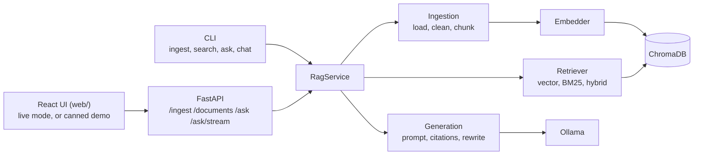
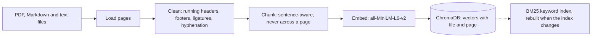
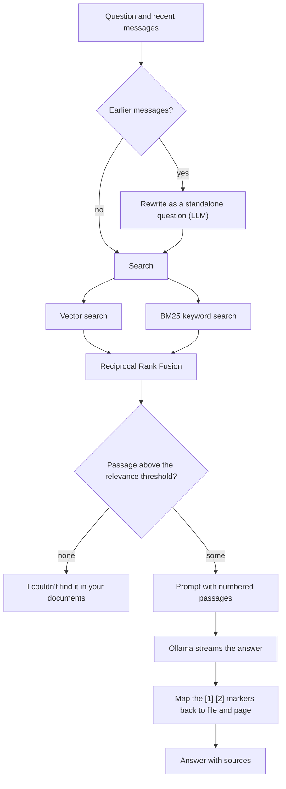

# Architecture

Overview:



Indexing a document:



Answering a question:



With Docker (`docker-compose.yml`) the pieces run as four containers:

```
browser -> web (nginx :8080)  -- static UI
                |  /api/*  (SSE not buffered)
                v
            api (uvicorn :8000) --> data/ (bind mount), chroma volume, baked embedding model
                |
                v
            ollama (:11434) <-- ollama-pull (downloads the model once)
```

## Rules

- Route handlers and CLI commands call only `RagService`; they never import retrieval,
  embedding or store modules directly.
- Every chunk carries `source` and `page`, and chunks never cross a page, so every result
  maps to one `[file, page]` citation. `Page.number` always matches the original file,
  even when empty pages were dropped.
- Embeddings are always computed by VectorNote and passed to Chroma; Chroma's own
  embedding functions and telemetry are not used.
- `data/` and `chroma_db/` are never committed.

## Ingestion

1. **Load** (`ingestion/loaders.py`): PDF through pymupdf, Markdown and text as one page.
2. **Clean** (`ingestion/cleaning.py`): ligatures, soft hyphens, hyphenated line breaks,
   whitespace; running headers, footers and page counters (English and French styles) are
   removed when they repeat at the edges of at least half the pages; empty pages are dropped.
3. **Chunk** (`ingestion/chunking.py`): lines and sentences packed up to 800 characters with
   up to 100 characters of overlap, made of whole sentences. A tiny trailing piece is merged
   into the previous chunk. IDs look like `lecture.pdf#p3-c1-9f2a1b7c`.
4. **Embed** (`embeddings/`): `all-MiniLM-L6-v2` through sentence-transformers, batched,
   L2-normalized, loaded lazily.
5. **Store** (`store/chroma_store.py`): persistent Chroma collection with cosine similarity.
   The embedding model name and each file's content hash are stored with the index.

`RagService.ingest_path` skips files whose content hash is unchanged. An edited file
replaces its old chunks only after the new embeddings were computed, so a failure never
leaves the index empty. Uploads are saved into `data/` under a sanitized name and only
replace an existing file once they ingest successfully.

## API

| Method | Path | Status |
|---|---|---|
| GET | `/health` | done |
| GET | `/documents` | done |
| POST | `/ingest` | done |
| POST | `/ask` | done |
| POST | `/ask/stream` | done (Server-Sent Events) |

## Retrieval

`retrieval/retriever.py` offers three modes, chosen per call or through `VECTORNOTE_RETRIEVAL_MODE`:

- **vector:** cosine similarity of embeddings, from ChromaDB.
- **bm25:** Okapi BM25 over every chunk (`retrieval/bm25.py`, no extra dependency). Text is
  lowercased and accent-folded, with a small English and French stop list. The index lives in
  memory and is rebuilt when the store's on-disk revision counter changes, so an `ingest` run in
  another process is picked up.
- **hybrid:** the top candidates of both rankers are merged with Reciprocal Rank Fusion
  (`1 / (60 + rank)` per list, `retrieval/fusion.py`). Only ranks are used, so cosine and BM25
  never need a common scale. Every hybrid result also carries its `vector_score` (cosine) and
  `bm25_score`, fetched from the store or index when only one ranker found it.

`SearchResult.score` is the score of the mode that produced it and is only comparable within
that mode. `min_score` is always a minimum cosine similarity, so it works in `vector` and
`hybrid` modes and is refused in `bm25` mode. This is the threshold Phase 3 uses to decide
that the notes do not cover a question.

## Answering

`RagService.ask` (generation code in `generation/`; with a `history`, step 0 is the follow-up rewrite described under Conversation memory):

1. **Gate:** retrieval runs with `min_score = VECTORNOTE_MIN_RELEVANCE` (a cosine threshold). With
   an empty index or no passage above the threshold, a fixed reply is returned and the model is
   never called. In `bm25` mode there is no cosine score, so the gate is skipped.
2. **Prompt:** the system prompt tells the model to use only the numbered passages, to cite them
   as `[n]`, and to reply `NOT_FOUND` when they do not contain the answer. The user message holds
   the passages (`[1] file, page N` followed by the text, within a 6000-character budget) and the
   question. Temperature is 0.1.
3. **Parse:** `[n]` markers (including `[1, 2]` and `[1][2]`) are mapped back to file and page;
   numbers outside the range are ignored as invented. `NOT_FOUND` becomes the same refusal reply
   as the gate. If the model cited nothing, the result is marked `cited = false` and lists all
   passages it was given, so the answer can still be checked.
4. **Errors:** `OllamaUnavailableError` (not running, timeout) and `OllamaModelNotFoundError`
   (`ollama pull <model>`) give one-line messages in the CLI and HTTP 503 from the API.

Numeric citations were chosen over `[file, page]` text because small local models copy a number
reliably but often garble file names; the API and CLI always map the numbers back to file and page.

## Streaming

`RagService.ask_stream` is a generator that yields `TokenEvent`s while the model writes and one
final `DoneEvent` carrying the same `AskResult` that `ask` returns. `OllamaClient.stream` reads
Ollama's newline-delimited JSON and yields only visible text.

- `ThinkFilter` removes `<think>...</think>` blocks even when a tag is split across chunks.
- `NotFoundGate` holds back the first few characters until it is clear that the reply is not the
  `NOT_FOUND` marker, so the marker never flashes on screen. When it is the marker, no token is
  sent and the `DoneEvent` carries the refusal text. The `done` answer is always authoritative.
- Everything that can fail before the first token (blank question, unknown mode, Ollama down,
  model missing) is raised when the first event is requested, so `/ask/stream` can answer with a
  proper HTTP status (422 or 503) instead of an event.
- A failure after streaming has started becomes an `error` event, because the status line has
  already been sent.

`/ask/stream` uses an **async** generator on purpose. When a client disconnects, Starlette
cancels the response at an `await`, and the `finally` block closes the service generator, which
closes the connection to Ollama and stops the generation. A plain (sync) generator is simply
abandoned in that situation, and the model keeps computing for nobody. `tests/test_stream_disconnect.py`
runs a real server to guard this.

SSE wire format:

```
event: token
data: {"text": "A mutex "}

event: done
data: {"answer": "...", "answered": true, "cited": true, "sources": [{"number": 1, ...}]}
```

## Conversation memory

The server is stateless: the client sends the earlier messages (`history`, at most 40, each
`user` or `assistant`) with every request, and the CLI `chat` command keeps them in memory.

When `history` is not empty and the index is not empty, `RagService` first asks the model to
rewrite the follow-up as a standalone question (`generation/rewrite.py`):

1. `trim_history` keeps the latest 6 messages, strips `[n]` citation markers and cuts each
   message to 600 characters, so the call stays small.
2. A short call (`max_tokens = 128`) with a system prompt that says: replace pronouns and vague
   references, keep the language of the follow-up, return it unchanged if already standalone,
   output only the question.
3. `clean_rewrite` accepts the reply only if it looks like a question: first line only, labels
   such as "Standalone question:" and quotes removed; an empty reply, `NOT_FOUND` or anything over
   300 characters (the model answering instead of rewriting) falls back to the original question.

The standalone question is what retrieval, the relevance gate, the answer prompt and the
refusal language use. `AskResult.standalone_question` and the API's `standalone_question` expose
it, and the stream sends a `query` event before the first token when it differs from what the
user typed, so a UI can show "Searching for: ...". The rewrite costs one extra model call, only
on follow-up turns. A failure of that call is an ordinary Ollama error (503), not silently ignored.
Unanswered turns are not added to the history by the `chat` command.

## Evaluation set

`eval/questions.jsonl` holds one question per line (`evaluation/dataset.py`): the question, its
`type` (factual, definition, comparison, procedure or unanswerable), `language`, every `expected`
`{source, page}` that answers it, a short `reference_answer`, optional `keywords` and an optional
`history` (a follow-up). Unknown fields are rejected, so a typo cannot silently drop a value.

`vectornote eval check` validates the file against the index. **Errors** (exit code 1) are
things that would make a metric wrong: duplicate ids, placeholder or unreviewed questions,
expected pages that do not exist in the index, answerable questions without pages or answers,
unanswerable questions that list pages. **Warnings** are advice: fewer than 30 questions, fewer
than 10% unanswerable ones (needed to tune the relevance threshold), one file supplying more than
half the questions, no follow-ups, and questions that repeat six or more words of the passage
they target. That last one matters because a question copied from the slide is found by any
search and inflates retrieval metrics.

`vectornote eval scaffold` drafts the file: it spreads the picks over files and pages (each page
used once before any repeats, tiny chunks skipped, seeded for repeatability), so every expected
page is real. Questions are placeholders for you to write. With `--suggest` the local model drafts
a question and answer per page; those drafts carry `needs_review`, and `check` fails until each
is reviewed. Drafts contain a `passage` field to help writing, which `check` asks you to delete
before committing, and `eval/draft*.jsonl` is git-ignored.

`eval/example/` is a small public corpus (a six-page PDF with a running header and footer, and a
French Markdown note) with 15 sample questions, so the workflow can be tried and tested without
private course files.

## Benchmark

`vectornote eval run` (`evaluation/runner.py`, `metrics.py`, `report.py`) scores the question set
against the index. It refuses to run while `eval check` reports errors, because the numbers would
describe a broken file.

**Retrieval** is measured for `vector`, `bm25` and `hybrid` side by side, offline and without the
language model:

- *Hit rate @k*: the share of answerable questions with at least one result on an expected page
  in the top k (reported at 1, 3, 5, ... up to `-k`). Ranks count chunks, so two chunks of one
  page take two ranks.
- *MRR*: the mean of `1 / rank` of the first expected page (0 when it is missing).
- *Latency*: p50, p95 and mean time of one `search` call, after a warm-up search so that loading
  the embedding model and building the BM25 index are not counted.
- *Relevance threshold table* (modes with cosine scores only): searches run without the gate,
  and for each cosine threshold the table shows how many answerable questions would still keep a
  passage and how many unanswerable ones would be refused. This is the data for choosing
  `VECTORNOTE_MIN_RELEVANCE`; the current value is marked.

Follow-up questions only make sense once rewritten, so retrieval skips them unless `--rewrite` is
given (one model call each, done once and shared by all modes). The summary says how many were
skipped.

**Answers** (`--answers`, needs Ollama) call `ask` for every question, follow-ups included:

- *Answered* and *refused correctly*: the false-refusal rate on answerable questions and the
  correct-refusal rate on unanswerable ones. The ids of both kinds of mistake are listed.
- *Citation on an expected page*: the answer has `[n]` markers and at least one points at an
  expected page. An answer without markers does not count, even though `ask` then falls back to
  listing all passages.
- *Keyword coverage*: the share of a question's `keywords` found in the answer.
- *Faithfulness* (`--judge`): the model is asked whether every claim of the answer is stated in
  the passages it was given. A small local model is a weak judge, so this is a signal to
  investigate, not a number to quote alone; `--output` saves every answer with its cited and
  retrieved pages so doubtful ones can be read by hand.
- *Latency*: the time `ask` takes (including query rewriting), without the judge.

`--format markdown` prints README-ready tables and `-o results.json` saves everything, along with
the settings used (embedding model, chunk size and overlap, threshold, k). Progress messages go
to stderr, so the tables can be redirected into a file. Saved runs are git-ignored.

Chunk size is read from `VECTORNOTE_CHUNK_SIZE` and `VECTORNOTE_CHUNK_OVERLAP`, so sizes can be
compared by indexing into one `VECTORNOTE_CHROMA_DIR` per size (see `eval/README.md`).
Reranking is not implemented yet, so there is nothing to compare it against.
